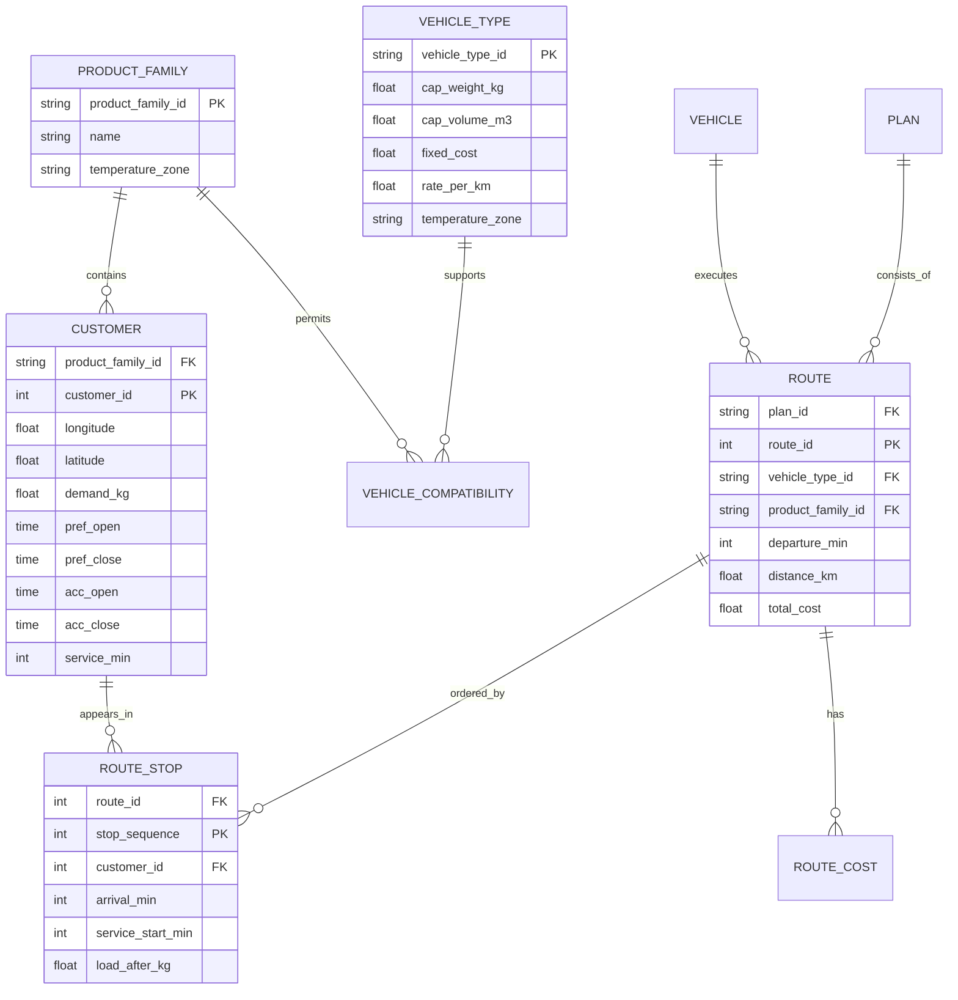

# 计算机学生交付说明：数据建模与智能调度系统

> 适用赛题：第六届四川省大学生物流设计大赛案例 2.3
> 场景：成都银犁冷藏物流股份有限公司，姜蒜与鲜面条两类产品的城市冷链配送
> 组合选题：2.1 经营分析与发展战略、2.3 城市冷链配送网络优化与智能调度、2.4 冷链仓储智能化管理。本文重点是 2.3 的可运行数据模型与算法，同时为 2.4 的仓配协同和 2.1 的经营 KPI 提供数据接口。
> 本文档可以直接作为计算机学生在小组报告、答辩 PPT 和代码附录中的主体材料。

## 0. 先说清楚交付边界

计算机学生不是只负责“做 PPT”或“画地图”，而是把案例中的业务问题转换成一个可计算、可验证、可复现的优化问题。建议把职责边界写成下面的形式：

| 模块 | 计算机学生主责 | 供应链同学主责 | 共同确认 |
| --- | --- | --- | --- |
| 原始数据 | 表 2-3 至 2-6 录入、清洗、单位统一 | 核对业务含义和案例原文 | 字段字典、异常值处理 |
| 数学模型 | 集合、变量、目标函数、约束 | 判断约束是否符合真实业务 | 温区、时间窗、车队规则 |
| 算法实现 | 基线、构造算法、局部搜索、随机重启 | 提供人工排程规则 | 对比方案是否公平 |
| 结果验证 | 客户覆盖、容量、时间窗、车队规模 | 核对成本和运营解释 | 所有硬约束必须通过 |
| 可视化 | 路线图、成本图、交互看板 | 提炼经营结论 | 图表不夸大、不误导 |
| 答辩演示 | 系统流程、模型公式、算法演示 | 讲业务价值、落地条件 | 统一口径和数字 |

参赛规则要求核心方案由学生完成。代码中使用了 AI 辅助的部分要在附录中标注用途，例如“辅助代码调试、文档排版、图表样式生成”，不能把 AI 生成内容伪装成完全人工完成。

## 1. 技术目标与问题定义

### 1.1 输入

案例提供的数据包括：

- 30 个姜蒜客户点：经纬度、大蒜需求、生姜需求、期望时间窗、可接受时间窗、服务时长；
- 30 个鲜面条客户点：经纬度、需求量、期望时间窗、可接受时间窗、服务时长；
- 2 类冷藏车：4.2 米小型车和 7.6 米中型车，共 8 台小型车、2 台中型车；
- 车辆容量、固定成本、运输成本、制冷成本、时间窗惩罚、货损率和产品单价。

### 1.2 决策

模型需要同时回答四个问题：

1. 每个客户由哪一辆车服务；
2. 每辆车的客户访问顺序是什么；
3. 每辆车几点从配送中心出发；
4. 在有限车队下，哪些路线使用小型车，哪些路线使用中型车。

### 1.3 输出

- 每辆车的客户顺序、载重、里程、发车时刻、服务开始时刻；
- 每条路线的固定成本、运输成本、制冷成本、时间窗惩罚和货损成本；
- 两类产品各自的路线数、车辆数、总里程和总成本；
- 两类产品各自以及整体的平均装载率与准时送达率等运营 KPI；
- 人工排程与智能调度的对比结果；
- 路线图、成本结构图和 HTML 交互看板。

### 1.4 验收标准

一个结果只有在同时满足以下条件时才算可行：

- 两类产品各 30 个客户，全部被服务且只被服务一次；
- 姜蒜和鲜面条不混装；
- 每条路线的载重和容积均不超过所选车型；
- 每个客户的服务开始时刻落在可接受时间窗内；
- 小型车不超过 8 台，中型车不超过 2 台；
- 所有计算可由脚本重复得到；
- 结论中的每个数字都能追溯到原始表或模型参数。

## 2. 循序渐进的实施路线

下面按照“先能跑通，再逐步变好”的顺序安排，避免一开始就追求复杂算法。

### 阶段 0：问题复述与数据盘点，0.5 天

目标：确认眼前到底是一个什么问题。

要做的事：

1. 从案例中抄录表 2-3、2-4、2-5、2-6，不直接复制到代码中；
2. 给每个字段补上单位，例如 kg、km、min、元/小时、元/公里；
3. 画出一张业务关系图：客户点、产品族、车辆、路线、成本参数；
4. 和供应链同学共同确认三个关键规则：
   - 姜蒜和鲜面条不能同车；
   - 可接受时间窗是硬约束还是软约束；
   - 8 台小型车和 2 台中型车是总量上限还是每日可用量。

交付物：数据字段清单、业务规则清单、问题边界说明。

验收方式：让一名没有看过案例的同学根据清单复述输入和输出，如果复述不出来，说明字段还没有解释清楚。

### 阶段 1：数据层实现，1 天

目标：把案例数据变成程序可以稳定读取的数据。

要做的事：

1. 建立 `data.py`，先保存原始数据，不在录入阶段做优化；
2. 用 `hhmm()` 将时间字符串统一转成“当日分钟数”；
3. 用 Haversine 公式计算配送中心与客户之间、客户与客户之间的球面距离；
4. 用重量除以假定的货物密度，折算体积；
5. 编写数据检查：
   - 客户编号是否重复；
   - 经纬度是否在合理范围；
   - 期望时间窗是否包含在可接受时间窗内；
   - 需求、服务时长是否为非负数；
   - 重量和体积是否可能超过车型容量。

交付物：`data.py`、`core.py` 中的距离与数据初始化部分、数据质量测试。

验收方式：运行数据测试，确认两类产品各有 30 个客户，姜蒜总需求 8831 kg，鲜面条总需求 2655 kg。

### 阶段 2：人工排程基线，1 天

目标：先得到一个“能解释”的对照方案。

要做的事：

1. 按可接受时间窗开启时间排序；
2. 依次把客户加入当前路线；
3. 只有容量、时间窗和产品兼容性都满足时才加入；
4. 装不下就新开一条路线；
5. 记录路线数、车辆数、总里程和总成本。

为什么需要基线：

- 避免只拿“优化后结果”自说自话；
- 让人工排程和智能调度在同样的成本函数下比较；
- 可以发现真实车队约束是否会被人工方案突破。

交付物：`baseline_solution()`、`baseline_fleet()`、基线运行结果。

验收方式：基线不一定要满足车队上限，但必须满足容量和客户时间窗，否则说明排程逻辑本身有错。本项目的基线使用 8 小 + 3 中，共 11 台，超过了 2 台中型车的上限，这是后续优化价值的关键证据。

### 阶段 3：优化模型与构造算法，2 天

目标：从“顺序排单”升级到“先优化路线，再分配车型”。

要做的事：

1. 将两类产品分成两个独立子问题；
2. 实现 Clarke-Wright 节约算法：
   - 初始时每个客户单独一条路线；
   - 计算合并两条路线的节约值；
   - 优先合并节约值最大的路线；
   - 合并前后检查容量、时间窗和产品温区；
3. 为每条路线从成本最低的可行车型开始；
4. 写目标函数，把固定成本、运输成本、制冷成本、时间窗惩罚和货损成本全部纳入；
5. 输出每条路线的成本明细，而不是只输出一个总数。

交付物：`solver.py`、`core.py` 的成本计算函数、初始优化路线。

验收方式：优化结果必须覆盖全部客户，并且总成本低于人工排程。若成本更低但出现客户遗漏，结果无效。

### 阶段 4：车队约束与局部搜索，1.5 天

目标：让数学上的路线方案真正适配银犁的 10 台车。

要做的事：

1. 建立车型指派函数：给定一批路线，判断能否用 8 小 + 2 中完成；
2. 对必须使用中型车的路线进行识别；
3. 对可选路线计算“小型车升级为中型车”的额外成本；
4. 优先把额外成本最低的路线升级为中型车，直到不超上限；
5. 依次实现以下局部搜索：
   - 路线内 2-opt：反转一段客户顺序，减少交叉里程；
   - relocate：把一个客户移到另一条同品类路线；
   - swap：交换两条同品类路线中的客户；
   - merge：尝试合并两条路线；
   - vehicle retype：在容量允许时切换小型车和中型车；
   - reduce-medium：中型车超限时，把最轻的中型路线拆分或降级；
6. 用 6 个不同的随机初始方案重复搜索，取目标值最小的方案；
7. 每接受一个移动，都重新检查容量、时间窗和车队数量。

交付物：`fleet.py`、联合搜索结果、车队可行性报告。

验收方式：运行 `validate.py`。优化方案必须通过全部硬约束，基线方案应当明确显示中型车超出上限。

### 阶段 5：可视化、复核与答辩，1 天

目标：让别人能在三分钟内看懂模型价值和结果。

要做的事：

1. 生成两张静态图：路线图和成本结构图；
2. 生成一张 HTML 看板：KPI、路线图、成本条形图、线路明细；
3. 检查图形是否出现错线、空图、重复路线或文字重叠；
4. 将主结论压缩成三句话：
   - 人工排程需要 11 台车，超过车队；
   - 智能调度在 10 台车限制内完成 60 个客户点；
   - 成本下降 1999 元，降幅 27.2%，总里程下降 37.2%；
5. 准备代码演示顺序、模型公式和可能被问到的问题。

交付物：`output/route_map.png`、`output/cost_compare.png`、`output/dashboard.html`、演示讲稿。

验收方式：随机抽一名组员，要求其独立讲清“输入、变量、目标、约束、结果”五个关键词。

## 3. 数据模型设计

### 3.1 概念模型

建议将数据分成四层：

1. 主数据层：产品族、客户、车辆；
2. 参数层：速度、制冷费率、惩罚费率、货损率、单价；
3. 计划层：路线、站点序列、发车时刻、车型；
4. 结果层：路线成本、车辆利用率、准时率、方案对比。

可以用下面的实体关系表示：



### 3.2 数据字典

#### 客户表

| 字段 | 类型 | 单位 | 说明 |
| --- | --- | --- | --- |
| product_family_id | 字符串 | 无 | `jiang` 或 `noodle` |
| customer_id | 整数 | 无 | 案例原始客户编号 |
| longitude | 浮点数 | 度 | 经度 |
| latitude | 浮点数 | 度 | 纬度 |
| demand_kg | 浮点数 | kg | 姜蒜合并后的需求，或鲜面条需求 |
| pref_open | 整数 | 分钟 | 期望时间窗开始 |
| pref_close | 整数 | 分钟 | 期望时间窗结束 |
| acc_open | 整数 | 分钟 | 可接受时间窗开始，硬约束 |
| acc_close | 整数 | 分钟 | 可接受时间窗结束，硬约束 |
| service_min | 浮点数 | 分钟 | 服务时长 |

姜蒜表在原始数据中拆成大蒜和生姜两列，计算时建议增加两个派生字段：

- `weight_kg = garlic_kg + ginger_kg`；
- `value_yuan = garlic_kg * garlic_price + ginger_kg * ginger_price`。

#### 车辆表

| 字段 | 类型 | 单位 | 小型车 | 中型车 |
| --- | --- | --- | --- | --- |
| vehicle_type_id | 字符串 | 无 | `small` | `medium` |
| available_count | 整数 | 台 | 8 | 2 |
| cap_weight_kg | 浮点数 | kg | 1500 | 7000 |
| cap_volume_m3 | 浮点数 | m³ | 15 | 38 |
| fixed_cost_yuan | 浮点数 | 元/车次 | 200 | 400 |
| transport_rate | 浮点数 | 元/km | 2.5 | 4.0 |
| max_range_km | 浮点数 | km | 600 | 600 |

#### 成本参数表

| 字段 | 单位 | 数值 | 说明 |
| --- | --- | --- | --- |
| speed_kmh | km/h | 40 | 平均车速 |
| refrig_drive | 元/h | 8.5 | 行驶制冷成本 |
| refrig_service | 元/h | 10.0 | 服务制冷成本 |
| early_penalty | 元/h | 5.0 | 早于期望窗口 |
| late_penalty | 元/h | 15.0 | 晚于期望窗口 |
| loss_transit | 比例 | 0.008 | 运输货损率 |
| loss_service | 比例 | 0.0016 | 服务货损率 |
| ginger_price | 元/kg | 3.0 | 生姜单价 |
| garlic_price | 元/kg | 3.2 | 大蒜单价 |
| noodle_price | 元/kg | 3.5 | 鲜面条单价 |

#### 路线结果表

| 字段 | 类型 | 说明 |
| --- | --- | --- |
| plan_id | 字符串 | `baseline` 或 `optimised` |
| route_id | 字符串 | 方案内路线编号 |
| product_family_id | 字符串 | 姜蒜或鲜面条 |
| vehicle_type_id | 字符串 | 小型车或中型车 |
| stop_sequence | 整数 | 站点顺序，从 1 开始 |
| customer_id | 整数 | 客户编号 |
| arrival_min | 整数 | 到达时刻 |
| service_start_min | 整数 | 服务开始时刻 |
| load_after_kg | 浮点数 | 离开该客户后的剩余载重 |
| departure_min | 整数 | 从配送中心发车时刻 |
| distance_km | 浮点数 | 路线总里程 |
| load_util_weight_pct | 浮点数 | 载重装载率，即载重 / 车型载重上限 |
| load_util_volume_pct | 浮点数 | 容积装载率，即体积 / 车型容积上限 |
| total_cost | 浮点数 | 路线总成本 |

### 3.3 数据质量规则

在正式求解前必须执行以下断言：

1. 每个产品族恰好有 30 个客户；
2. 同一产品族内客户编号唯一；
3. 所有需求量、服务时长和单价非负；
4. `acc_open <= pref_open <= pref_close <= acc_close`；
5. 经纬度在合理范围内，且与配送中心距离不超过服务半径；
6. 任一客户的单点需求不超过中型车容量；
7. 所有时间均转换为“当日 0 点后的分钟数”，避免字符串比较；
8. 所有成本字段在汇总前保留浮点数，展示时再四舍五入。

### 3.4 数据到模型的映射

| 业务对象 | 模型对象 | 说明 |
| --- | --- | --- |
| 配送中心 | 节点 0 | 所有路线从这里出发并返回 |
| 客户点 | 节点 1 至 n | 每个产品族单独编号 |
| 产品族 | 子问题 p | 姜蒜和鲜面条分别求解 |
| 一辆车的一次出车 | 一条路线 r | 不允许中途换车或混装 |
| 载重限制 | 容量约束 | 重量和体积都要检查 |
| 期望时间窗 | 软惩罚 | 早到 5 元/h，晚到 15 元/h |
| 可接受时间窗 | 硬约束 | 超出即判定路线不可行 |
| 车辆固定成本 | 目标函数第一项 | 使用一次即产生 |
| 运输距离 | 目标函数第二项 | Haversine 距离乘以费率 |
| 冷链设备运行 | 目标函数第三项 | 行驶和服务分别计时 |

## 4. 数学规划模型

### 4.1 集合与索引

- \(P=\{1,2\}\)：产品族集合，1 表示姜蒜，2 表示鲜面条；
- \(N_p=\{0,1,\dots,n_p\}\)：产品族 \(p\) 的节点集合，0 为配送中心；
- \(K_S\)：小型车集合，\(|K_S|=8\)；
- \(K_M\)：中型车集合，\(|K_M|=2\)；
- \(K=K_S\cup K_M\)：全部可用车辆；
- \(A_p=\{(i,j): i,j\in N_p,\ i\ne j\}\)：产品族 \(p\) 的可行弧集合。

### 4.2 参数

| 符号 | 含义 | 单位 |
| --- | --- | --- |
| \(q_i\) | 客户 \(i\) 的需求重量 | kg |
| \(v_i\) | 客户 \(i\) 的需求体积 | m³ |
| \(s_i\) | 客户 \(i\) 的服务时长 | min |
| \(e_i,l_i\) | 客户 \(i\) 的期望时间窗 | min |
| \(a_i,b_i\) | 客户 \(i\) 的可接受时间窗 | min |
| \(d_{ij}\) | 节点 \(i\) 到 \(j\) 的距离 | km |
| \(W_k,V_k\) | 车辆 \(k\) 的重量和容积上限 | kg, m³ |
| \(F_k\) | 车辆 \(k\) 的固定成本 | 元 |
| \(c_k\) | 车辆 \(k\) 的单位里程成本 | 元/km |
| \(L_i\) | 客户 \(i\) 的货物价值 | 元 |
| \(r_t,r_s\) | 运输和服务货损率 | 无 |
| \(\rho_d,\rho_s\) | 行驶和服务制冷费率 | 元/h |
| \(\pi_e,\pi_l\) | 早到和晚到惩罚 | 元/h |
| \(v\) | 平均速度 | km/h |

### 4.3 决策变量

$$
x_{ijk}\in\{0,1\}
\quad
\text{表示车辆 }k\text{ 是否从节点 }i\text{ 直接行驶到节点 }j
$$

$$
y_{ik}\in\{0,1\}
\quad
\text{表示客户 }i\text{ 是否由车辆 }k\text{ 服务}
$$

$$
t_{ik}\ge 0
\quad
\text{表示车辆 }k\text{ 对客户 }i\text{ 的服务开始时间}
$$

$$
u_{ik}\ge 0
\quad
\text{表示车辆 }k\text{ 离开客户 }i\text{ 后的累计载重}
$$

$$
z_{kp}\in\{0,1\}
\quad
\text{表示车辆 }k\text{ 是否执行产品族 }p\text{ 的路线}
$$

### 4.4 目标函数

$$
\begin{aligned}
\min \quad
& \sum_{k\in K}(F_k z_k) \\
&+\sum_{k\in K}\sum_{(i,j)\in A} c_k d_{ij} x_{ijk} \\
&+\sum_{k\in K}\left(
\rho_d \frac{\sum_{i,j} d_{ij}x_{ijk}}{v}
+\rho_s \frac{\sum_i s_i y_{ik}}{60}
\right) \\
&+\sum_{k\in K}\sum_{i\in N}
\left[
\pi_e \frac{\max(0,e_i-t_{ik})}{60}
+\pi_l \frac{\max(0,t_{ik}-l_i)}{60}
\right] \\
&+\sum_{k\in K}\sum_{i\in N} L_i(r_t+r_s)y_{ik}
\end{aligned}
$$

其中 \(z_k=1\) 表示车辆被使用。

### 4.5 约束条件

**每个客户恰好被一辆车服务：**

$$
\sum_{k\in K} y_{ik}=1,\qquad \forall i\in N
$$

**流平衡：**

$$
\sum_{j\in N,j\ne i} x_{ijk}
=
\sum_{j\in N,j\ne i} x_{jik}
=
y_{ik},
\qquad \forall i\in N,\ k\in K
$$

**配送中心至多发一次车：**

$$
\sum_{j\in N\setminus\{0\}} x_{0jk}=z_k,
\qquad \forall k\in K
$$

**服务时间递推：**

$$
t_{jk}\ge t_{ik}+s_i+\frac{d_{ij}}{v}-M(1-x_{ijk})
$$

**硬时间窗：**

$$
a_i-M(1-y_{ik})\le t_{ik}\le b_i+M(1-y_{ik})
$$

**载重递推与容量：**

$$
u_{jk}\ge u_{ik}+q_j-M(1-x_{ijk})
$$

$$
q_i\le u_{ik}\le W_k
$$

**容积约束：**

$$
\sum_{i\in N} v_i y_{ik}\le V_k,
\qquad \forall k\in K
$$

**产品不混装：**

$$
\sum_{i\in N_1} y_{ik}\le |N_1|z_{k1},
\qquad
\sum_{i\in N_2} y_{ik}\le |N_2|z_{k2},
\qquad
z_{k1}+z_{k2}\le 1
$$

**车型数量约束：**

$$
\sum_{k\in K_S} z_k\le 8,
\qquad
\sum_{k\in K_M} z_k\le 2
$$

**发车时间约束：**

$$
T^{open}\le departure_k\le T^{close}
$$

**变量定义域：**

$$
x_{ijk},y_{ik},z_{kp}\in\{0,1\},\qquad
t_{ik},u_{ik}\ge 0
$$

### 4.6 模型中的业务解释

- 产品不混装不是附加条件，而是把姜蒜和鲜面条拆成两个互不共享客户的子问题；
- 可接受时间窗负责保证可行性，期望时间窗负责表达服务水平；
- 制冷成本既与行驶时间有关，也与服务时间有关，因此“少走几公里”不一定总是最优，停车过久也会增加成本；
- 固定成本让模型倾向减少车辆数，但车辆数减少后，路线可能变长，必须在两类成本间权衡；
- 8 小 + 2 中是总量约束，不是建议值，只有满足这个约束的方案才具有落地价值。

## 5. 算法设计

精确求解车辆路径问题在大规模场景下计算量很高。本项目采用“构造加改进加车队修复”的启发式算法，适合比赛演示，也便于解释。

### 5.1 总体流程

```text
读取案例数据
  -> 清洗和单位统一
  -> 按产品族拆成两个 VRPTW 子问题
  -> 人工排程基线
  -> Clarke-Wright 构造初始路线
  -> 车型初分配
  -> 车队可行性修复
  -> 局部搜索改进
  -> 多随机初值重启
  -> 独立约束校验
  -> 输出 CSV、JSON、HTML 和 PNG
```

### 5.2 基线算法

基线模拟调度员的顺序排程习惯：

1. 按可接受时间窗开启时间排序；
2. 把一个客户加入当前路线；
3. 检查产品兼容、载重、容积和硬时间窗；
4. 不满足就新开一条路线；
5. 输出路线和成本，不做额外优化。

基线的作用是提供公平对照，不是作为最终方案。

### 5.3 Clarke-Wright 节约算法

两条路线中如果存在边 \((i,0)\) 和 \((0,j)\)，把路线 1 的末端 \(i\) 接到路线 2 的起点 \(j\) 上，可以节省：

$$
S_{ij}=d_{i0}+d_{0j}-d_{ij}
$$

算法步骤：

1. 为每个客户建立一条“配送中心到客户再回配送中心”的初始路线；
2. 计算所有客户对的节约值；
3. 从节约值最大的客户对开始尝试合并；
4. 如果两个客户在同一条路线内、合并后超载或违反时间窗，则跳过；
5. 重复直到不能再合并。

### 5.4 车型指派

给定一批已经形成的路线，需要决定哪些使用小型车、哪些使用中型车。

处理顺序：

1. 如果某条路线超过小型车容量，则强制使用中型车；
2. 如果强制中型车数量已经超过 2，当前路线集合直接判定不可行；
3. 对其余路线计算“升级为中型车需要增加的成本”；
4. 为了满足最多 8 条小型路线的限制，优先升级增量成本最低的路线；
5. 如果可用中型车槽位不足，则拒绝当前候选解。

因为只有两种车型，而且中型车数量最多 2 台，这一步可以在很小的时间内完成，并且可以给出确定性的最省指派。

### 5.5 局部搜索

| 算子 | 操作 | 目的 |
| --- | --- | --- |
| 2-opt | 反转路线中的一段 | 消除路线交叉，缩短里程 |
| relocate | 将一个客户移动到另一条同品类路线 | 平衡路线负载和长度 |
| swap | 交换两条同品类路线中的客户 | 改善客户与路线的匹配 |
| merge | 尝试合并两条路线 | 减少车辆数和固定成本 |
| retype | 切换小型车和中型车 | 在容量和成本之间权衡 |
| reduce-medium | 拆分最轻的中型车路线 | 修复中型车超限 |

每接受一次移动都必须重新计算硬时间窗、载重、容积和车队数量。不可行的候选解不能进入目标函数比较。

### 5.6 随机重启

不同初始排序会得到不同的局部最优解。项目使用固定随机种子生成 6 个初始方案，分别执行局部搜索，最后选择目标值最小的方案。

固定种子有三个好处：

- 结果可复现；
- 答辩时可以解释为什么每次运行数字相同；
- 调试时可以定位具体是哪一个初始方案产生了错误。

### 5.7 复杂度控制

- 客户规模：60 个，其中每个产品族 30 个；
- 距离矩阵：每个产品族构建 \((31\times31)\) 的矩阵；
- 主要耗时在局部搜索的路线内和路线间组合；
- 通过提前容量判断、时间窗快速失败和成本缓存控制重复计算；
- 6 次随机重启的总运行时间仍然可以控制在秒级，适合现场演示。

## 6. 实现文件说明

| 文件 | 作用 | 主要入口 |
| --- | --- | --- |
| `data.py` | 原始数据、车辆参数、成本参数、时间转换 | 无 |
| `core.py` | 距离矩阵、调度、成本核算、容量和车型选择 | `Problem` |
| `solver.py` | 基线排程、Clarke-Wright、单产品局部搜索 | `baseline_solution()`、`clarke_wright()` |
| `fleet.py` | 车队约束、车型指派、跨路线搜索、随机重启 | `solve_fleet()`、`baseline_fleet()` |
| `run.py` | 主流程和 CSV/JSON 输出 | `main()` |
| `validate.py` | 独立约束校验 | `validate()` |
| `dashboard.py` | 生成自包含 HTML 看板 | `main()` |
| `render_map.py` | 生成路线图和成本结构图 | `main()` |
| `test_model.py` | 数据质量与优化结果验收测试 | `unittest` |

推荐运行顺序：

```bash
python run.py
python validate.py
python dashboard.py
python render_map.py
python -m unittest -v test_model.py
```

## 7. 数据建模结果

### 7.1 当前结果

| 指标 | 人工排程 | 智能调度 |
| --- | --- | --- |
| 总成本 | 7344 元 | 5345 元 |
| 车辆配置 | 8 小 + 3 中 | 8 小 + 2 中 |
| 车辆总数 | 11 台 | 10 台 |
| 姜蒜里程 | 618.7 km | 402.0 km |
| 鲜面条里程 | 568.8 km | 343.5 km |
| 总里程 | 1187.5 km | 745.5 km |
| 车队可行性 | 超出中型车上限 | 满足 |
| 平均装载率（重量） | 36.1% | 48.6% |
| 平均装载率（体积） | 17.5% | 22.0% |
| 准时送达率（期望时间窗） | 43.3% | 48.3% |
| 硬时间窗达成率 | 100% | 100% |

分品类装载率（重量）：

| 品类 | 人工排程 | 智能调度 |
| --- | --- | --- |
| 姜蒜 | 44.1% | 61.7% |
| 鲜面条 | 29.5% | 35.4% |

主要结论：

- 成本节省 1999 元，下降 27.2%；
- 总里程减少 442.0 km，下降 37.2%；
- 人工排程需要 11 台车，超过真实车队 1 台；
- 优化方案用满 10 台车，在 8 小 + 2 中的限制内完成 60 个客户点；
- 平均装载率由 36.1% 提升到 48.6%，准时送达率由 43.3% 提升到 48.3%。

### 7.2 运营 KPI 口径

`fleet.plan_metrics()` 统一计算两项运营指标，`run.py`、`validate.py` 和看板使用同一套口径：

- **装载率** = 各路线 `载重 / 所选车型载重上限` 的平均值；同时给出体积口径 `体积 / 车型容积上限`。姜蒜与鲜面条分品类单独统计。
- **准时送达率** = 服务开始时刻落在**期望时间窗**内的站点占比，衡量服务水平；**硬时间窗达成率** 使用可接受时间窗，属于可行性硬约束，必须为 100%。

注意：准时送达率以“期望时间窗”为分母，因此可以低于 100%；硬时间窗达成率恒为 100%，否则方案判为不可行。

### 7.3 建议补充的敏感性分析

正式答辩前，建议再补三组实验，增强模型的稳健性说明：

| 情景 | 调整方式 | 观察指标 |
| --- | --- | --- |
| 需求上升 | 所有需求量增加 10% | 是否仍满足 10 台车限制，成本上升多少 |
| 车速下降 | 平均车速从 40 降到 35 km/h | 时间窗惩罚和车辆数如何变化 |
| 货损下降 | 货损率下降 20% | 对总成本和路线排序的影响 |
| 中型车减少 | 中型车从 2 台降为 1 台 | 方案是否可行，需要增加多少成本 |
| 早到惩罚提高 | 早到惩罚从 5 提高到 10 元/h | 发车时刻是否更集中、路线是否改变 |

敏感性分析的作用不是增加复杂公式，而是回答评委最关心的问题：如果现实条件稍有变化，方案是否还成立。

## 8. 与供应链同学的接口

为了保证四个人的工作能合并，计算机学生需要向供应链同学提供固定接口，而不是只在群里发一张截图。

### 8.1 供应链同学需要提供的输入

- 每个字段的业务含义和单位；
- 时间窗究竟代表客户收货时间还是车辆到达时间；
- 姜蒜和鲜面条的温区要求；
- 人工排程的实际规则和例外情况；
- 哪些成本是每次出车固定发生，哪些按公里或小时发生；
- 方案落地时需要额外考虑的装卸、月台、司机工时等限制。

### 8.2 计算机学生需要回传的输出

- 客户字段字典和原始数据核对表；
- 每条路线的客户顺序、车型、发车时间和成本明细；
- 人工排程与智能调度的同口径对比表；
- 可行性校验结果；
- 路线图、成本图、HTML 看板；
- 代码运行命令和结果复现说明。

### 8.3 统一口径

所有对外材料建议统一使用下面的数字：

- 人工排程总成本：7344 元；
- 智能调度总成本：5345 元；
- 节省金额：1999 元；
- 节省比例：27.2%；
- 路线数：11 条降至 10 条；
- 车辆配置：8 小 + 3 中降至 8 小 + 2 中；
- 总里程：1187.5 km 降至 745.5 km；
- 里程下降比例：37.2%；
- 平均装载率：36.1% 提升至 48.6%（体积口径 17.5% → 22.0%）；
- 准时送达率：43.3% 提升至 48.3%，硬时间窗达成率保持 100%。

如果后续调整模型参数，必须同步更新所有图表和讲稿，避免答辩时出现两套数字。

## 9. 答辩演示建议

计算机学生建议控制在 6 至 8 分钟，讲清五个问题即可。

1. 这是什么问题：双品类、温区不同、固定车队、带时间窗的车辆路径优化。
2. 数据怎么变成模型：客户、车辆、路线、成本四类对象，姜蒜和鲜面条拆成两个子问题。
3. 目标是什么：固定成本、运输成本、制冷成本、时间窗惩罚和货损成本之和最小。
4. 算法怎么工作：人工基线、Clarke-Wright、车型指派、局部搜索、随机重启。
5. 结果为什么可信：全部客户覆盖、容量满足、硬时间窗满足、车队不超过 8 小 + 2 中，且有独立校验脚本。

现场演示顺序：

```text
python run.py
python validate.py
python dashboard.py
python render_map.py
python -m unittest -v test_model.py
```

答辩时不要把代码逐行念出来。先展示 `validate.py` 的通过结果，再展示 `dashboard.html`，最后用 `route_map.png` 和 `cost_compare.png` 解释路线与成本变化。

## 10. 风险、局限与后续扩展

### 10.1 当前局限

- 体积采用 250 kg/m³ 的假定密度，实际装载需要按货物形态重新标定；
- 货损目前按需求比例计算，没有随在途时长变化；
- 未建模同一车辆跨品类二次出车；
- 未建模司机工时、月台排队、装卸等待和交通波动；
- 案例数据经过掩饰，成本绝对值主要用于方案比较。

### 10.2 可扩展方向

- 将货损率改成随在途时间变化的函数；
- 增加多车场、多配送中心和跨区域调拨；
- 增加司机工作时间和休息约束；
- 增加动态订单和实时车辆位置；
- 用 OR-Tools、Gurobi 或 CPLEX 对小规模实例求精确解，与本启发式结果对照；
- 将路线结果接入地图 API，生成真实道路距离和预计到达时间；
- 将模型封装成网页表单，供调度人员输入当日订单并一键生成路线。

## 11. 最终验收清单

- [ ] 原始数据全部可追溯到案例表 2-3 至 2-6；
- [ ] 客户编号和需求数量通过自动测试；
- [ ] 姜蒜与鲜面条不混装；
- [ ] 每条路线不超过重量和容积上限；
- [ ] 每个客户都在可接受时间窗内被服务；
- [ ] 小型车不超过 8 台，中型车不超过 2 台；
- [ ] 优化方案覆盖全部 60 个客户且无重复；
- [ ] 人工基线和智能调度使用同一套成本参数；
- [ ] 关键结论可由脚本重新生成；
- [ ] 平均装载率与准时送达率由 `plan_metrics()` 统一计算，并与 `summary.json` 的 `kpi` 字段一致；
- [ ] `routes.csv` 的装载率列与所选车型容量口径一致；
- [ ] HTML 看板和 PNG 图片中的数字与 `summary.json` 一致；
- [ ] AI 辅助内容已标注，核心方案由学生完成；
- [ ] 答辩讲稿、结果数字和图表口径一致。
